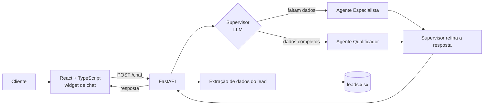

# Funil_AgentsAI

Funil de vendas conduzido por agentes de IA. Uma assistente virtual conversa com o cliente, descobre o que ele quer, qualifica o lead e grava os dados prontos para o time comercial. O exemplo de negócio é uma decoradora de festas e eventos, mas a arquitetura serve para qualquer funil de atendimento.

> **EN:** Sales funnel run by AI agents. A virtual assistant chats with the customer, collects event details, qualifies the lead and stores it for the sales team. Built with FastAPI, LangChain and Gemini on the backend and a React + TypeScript chat widget on the frontend. Example domain: party and event decoration.

## O que ele faz

- **Conversa guiada por agentes.** Um agente supervisor decide, a cada mensagem, quem responde: o especialista (coleta detalhes da festa e sugere inspirações) ou o qualificador (confirma data, convidados e orçamento e decide se o lead está qualificado).
- **Extração de dados do lead** direto do texto da conversa: nome, tipo de festa, convidados, orçamento, telefone, e-mail, local, bufê, música, cerimonialista, cores e data.
- **Gravação dos leads** em planilha (`leads.xlsx`) quando os dados de contato obrigatórios estão completos.
- **Sessões com histórico** por `session_id`, com endpoint para recuperar a conversa e os dados do lead.
- **Frontend em React** com landing page, widget de chat, painel administrativo e status do funil.

## Arquitetura



Cada agente é um prompt especializado sobre o mesmo modelo (`gemini-2.5-pro`, via LangChain). O supervisor classifica a mensagem, o agente escolhido responde e o supervisor reescreve a resposta no tom da marca antes de enviar ao cliente.

## Stack

| Camada | Tecnologia |
|---|---|
| Backend | Python, FastAPI, Uvicorn, Pydantic |
| Agentes e LLM | LangChain, Google Gemini (`gemini-2.5-pro`) |
| Dados | pandas e openpyxl (planilha de leads) |
| Frontend | React, TypeScript, Tailwind CSS, Radix UI |
| Protótipo anterior | Streamlit (`app.py`) |

## Estrutura

```
Funil_AgentsAI/
├── api_server.py          # API FastAPI: chat, histórico, leads
├── prompts.py             # prompts do supervisor, especialista e qualificador
├── app.py                 # protótipo inicial em Streamlit
├── supervisor.py          # classes do protótipo Streamlit
├── especialista.py
├── qualificador.py
├── config.example.yaml    # modelo de configuração (copie para config.yaml)
├── requirements.txt
└── frontend/              # React + TypeScript
```

## Como rodar

### 1. Backend

```bash
git clone https://github.com/igortavaresalves/Funil_AgentsAI.git
cd Funil_AgentsAI

python -m venv .venv
source .venv/bin/activate          # Windows: .venv\Scripts\activate
pip install -r requirements.txt

cp config.example.yaml config.yaml # Windows: copy config.example.yaml config.yaml
```

Edite o `config.yaml` e preencha ao menos a `GOOGLE_API_KEY` (https://aistudio.google.com). O arquivo está no `.gitignore` e não deve ser commitado.

```bash
python api_server.py               # API em http://localhost:8000 (docs em /docs)
```

### 2. Frontend

```bash
cd frontend
npm install
npm start                          # http://localhost:3000
```

O widget fala com a API em `http://localhost:8000`.

### Protótipo em Streamlit (opcional)

```bash
streamlit run app.py
```

## Endpoints

| Método | Rota | Descrição |
|---|---|---|
| `POST` | `/chat` | Envia uma mensagem e recebe a resposta do agente |
| `GET` | `/history/{session_id}` | Histórico da conversa e dados do lead |
| `POST` | `/lead` | Salva um lead manualmente |

## Limitações conhecidas e próximos passos

- Sessões ficam em memória: trocar por Redis ou banco de dados.
- Leads gravados em planilha: migrar para um banco e um CRM.
- CORS aberto (`*`) para desenvolvimento: restringir as origens em produção.
- Extração de dados por regras de texto: evoluir para saída estruturada do LLM.
- Sem testes automatizados: cobrir a extração de dados e a decisão do supervisor.
- Segredos: usar variáveis de ambiente em vez de arquivo de configuração.

## Autor

Igor Tavares, desenvolvedor backend e de soluções com IA, Recife (PE). [GitHub](https://github.com/igortavaresalves)
