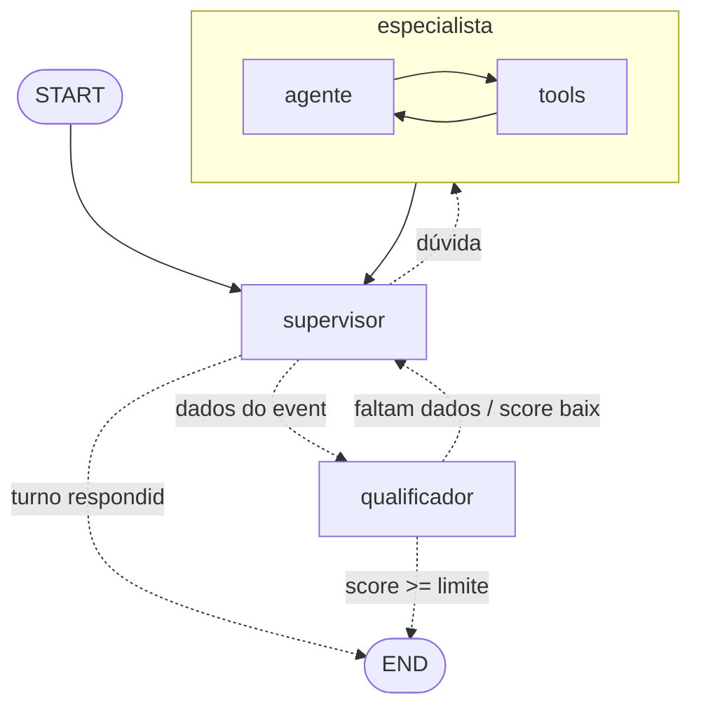

# Funil_AgentsAI

Funil de vendas multiagente para uma decoradora de festas (persona: Rosalina Montenegro),
construído com **LangGraph**. A cliente conversa num chat; um supervisor decide se quem
responde é a especialista do produto ou a qualificadora, que coleta os dados do evento,
calcula um score e marca o lead como qualificado.

## Arquitetura



| Peça | Arquivo | O que faz |
| --- | --- | --- |
| Estado | [`funil_agents/state.py`](funil_agents/state.py) | `messages` (reducer `add_messages`), `lead` (sem reducer: sempre devolver o lead completo), `proxima_etapa`, `aprovado` |
| Supervisor | [`funil_agents/nodes/supervisor.py`](funil_agents/nodes/supervisor.py) | Decide o próximo nó com saída estruturada (`Roteamento`). Se um agente já respondeu ao turno, encerra sem chamar o LLM |
| Especialista | [`funil_agents/nodes/especialista.py`](funil_agents/nodes/especialista.py) | Subgrafo com loop de ferramentas próprio (`ToolNode` + `tools_condition`) sobre o [catálogo](funil_agents/catalogo.py) |
| Qualificador | [`funil_agents/nodes/qualificador.py`](funil_agents/nodes/qualificador.py) | Extrai os dados (`DadosLead`), mescla com o lead existente, calcula o [score](funil_agents/score.py) e pede o que falta |
| Grafo | [`funil_agents/graph.py`](funil_agents/graph.py) | `StateGraph` + arestas; `run_config()` aplica o `recursion_limit` |
| API | [`api/main.py`](api/main.py) | FastAPI fino: `POST /chat` invoca o grafo |
| Frontend | [`frontend/`](frontend) | React + Vite + Tailwind, chat em `ChatSection.tsx` |

### Score do lead (0 a 100)

- 10 pontos por campo preenchido: nome, tipo de festa, convidados, orçamento e data (até 50).
- Orçamento por convidado: R$ 150 ou mais = 30, R$ 80 ou mais = 20, R$ 40 ou mais = 10.
- Prazo: de 30 dias a 1 ano = 20; menos de 30 dias ou mais de 1 ano = 10; data passada = 0.

Qualificado quando os 5 campos estão preenchidos e o score é maior ou igual a `SCORE_LIMITE` (padrão 70).

## Como rodar

Pré-requisitos: Python 3.11+ e Node 20+.

**Backend** (Windows PowerShell):

```powershell
python -m venv .venv
.venv\Scripts\Activate.ps1
pip install -r requirements.txt
copy .env.example .env   # e preencha a GOOGLE_API_KEY
uvicorn api.main:app --reload
```

**Frontend:**

```powershell
cd frontend
npm install
npm run dev   # http://localhost:5173
```

**Testes** (usam um LLM falso, não gastam chamadas ao Gemini):

```powershell
pytest
```

Os leads qualificados são gravados em `data/leads.xlsx` (fora do Git, pois contém dados de clientes).

## Roadmap

Ordem definida na aula de LangGraph (12/11/2026), um commit por parte:

- [x] **Parte 1**: Supervisor, Especialista e Qualificador em LangGraph, sem memória.
  Por enquanto a API guarda o estado de cada sessão num dicionário em memória.
- [ ] **Parte 2**: checkpointer e memória. `PostgresSaver` em produção (`SqliteSaver` no
  desenvolvimento), um `thread_id` por lead, corte ou resumo do histórico antigo.
- [ ] **Parte 3**: aprovação humana com `interrupt` antes de enviar a proposta ou passar o lead ao
  comercial, e um nó de **ação final** isolado (que só roda depois da aprovação, e uma única vez).
  Observabilidade com Arize Phoenix.
