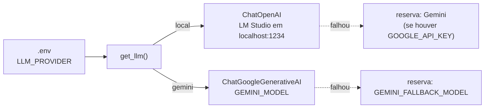

# Modelo de linguagem (LLM)

Como o funil escolhe e chama o modelo, como rodar com um modelo local pelo LM Studio,
o que foi testado e os problemas já resolvidos.

## Visão geral

Todos os nós do grafo recebem o modelo por injeção (`build_graph(llm=...)`), então trocar de
provedor não muda nenhum nó. Quem decide o modelo é [`funil_agents/llm.py`](../funil_agents/llm.py),
a partir do `.env`:



| `LLM_PROVIDER` | Onde roda | Custo | Reserva automática |
| --- | --- | --- | --- |
| `local` | No seu PC, pelo LM Studio | Grátis; nenhuma mensagem sai da máquina | Gemini, se a `GOOGLE_API_KEY` estiver preenchida |
| `gemini` (padrão do código) | API do Google | Cota grátis no AI Studio, depois pago | `GEMINI_FALLBACK_MODEL` |

O `.env.example` já vem com `LLM_PROVIDER=local`.

## Rodando com modelo local (LM Studio)

1. Instale o [LM Studio](https://lmstudio.ai).
2. Na busca do app, baixe o **Qwen3 4B Instruct 2507** (cerca de 2,5 GB).
3. Na aba **Developer**, carregue o modelo e clique em **Start Server** (porta 1234).
4. Confira o nome exato do modelo, que deve ir para o `LOCAL_MODEL` do `.env`:

   ```bash
   curl http://localhost:1234/v1/models
   ```

5. Suba a API e o frontend normalmente (veja o [README](../README.md#como-rodar)).

**Por que a biblioteca `langchain-openai`?** O LM Studio expõe uma API no mesmo formato da
OpenAI. A biblioteca é só o cliente: não há conta, chave nem cobrança da OpenAI, e o servidor é
o seu próprio PC. O valor `api_key="lm-studio"` no código existe só porque o cliente exige um
valor, e o LM Studio o ignora.

### Escolhendo o modelo local

O funil precisa de um modelo que faça **chamada de ferramentas** (Especialista) e **saída
estruturada** (Supervisor e Qualificador). Para o hardware testado:

| Hardware | Recomendação |
| --- | --- |
| GPU com 4 GB (ex.: GTX 1050 Ti) | Qwen3 4B Instruct: cabe inteiro na placa |
| GPU com 8 GB ou mais | Um modelo 7B a 8B: melhor português e menos erros de roteamento |
| Só CPU | Funciona com 4B, mas espere bem mais que 30 s por resposta |

Prefira a versão **instruct** (sem modo de raciocínio): ela responde direto, sem gerar
"pensamento" antes, o que economiza tempo em todas as chamadas.

## Configuração

Todas as variáveis ficam no `.env` (modelo em [`.env.example`](../.env.example)) e são lidas
em [`funil_agents/config.py`](../funil_agents/config.py).

| Variável | Padrão | Para que serve |
| --- | --- | --- |
| `LLM_PROVIDER` | `gemini` | `local` ou `gemini` |
| `LOCAL_BASE_URL` | `http://localhost:1234/v1` | Endereço do servidor do LM Studio |
| `LOCAL_MODEL` | `qwen3-4b-instruct-2507` | Nome do modelo, como aparece em `/v1/models` |
| `LOCAL_TIMEOUT` | `180` | Segundos por chamada ao modelo local |
| `GOOGLE_API_KEY` | (vazio) | Chave do [AI Studio](https://aistudio.google.com/apikey). Com `local`, é opcional e ativa o Gemini como reserva |
| `GEMINI_MODEL` | `gemini-3.8-flash` | Modelo principal do Gemini |
| `GEMINI_FALLBACK_MODEL` | `gemini-3.5-flash-lite` | Reserva quando o principal falha (deixe vazio para desligar) |
| `LLM_TIMEOUT` | `30` | Segundos por chamada ao Gemini |
| `LLM_MAX_RETRIES` | `1` | Novas tentativas no Gemini antes de ir para a reserva |

## Modelo reserva

`ModeloComReserva` (em `llm.py`) envolve o modelo principal e, se a chamada falhar, refaz a
**mesma** chamada no reserva. Vale para os três usos do funil:

- `invoke` (respostas de texto)
- `bind_tools` (loop de ferramentas da Especialista)
- `with_structured_output` (decisão do Supervisor e extração do Qualificador)

Junto com o timeout e o limite de tentativas, isso evita que uma instabilidade do provedor
deixe a conversa travada. Se o principal e o reserva falharem, a API responde `502` com uma
mensagem amigável, e o frontend mostra o erro.

## Resultados do teste local (23/11/2026)

Modelo `qwen3-4b-instruct-2507` no LM Studio, GPU GTX 1050 Ti (4 GB), 16 GB de RAM,
**sem** o Gemini de reserva (para nenhuma falha ficar escondida).

| Mensagem da cliente | Agente | Resultado | Tempo |
| --- | --- | --- | --- |
| "Vocês fazem decoração de casamento? Quanto custa?" | Especialista | Chamou `consultar_pacote` e respondeu R$ 15.000 | 16 s |
| "Sou a Ana Souza e vou casar no dia 15 de agosto do ano que vem" | Qualificador | Extraiu nome, `casamento` e `2027-08-15`; pediu convidados e orçamento | 17 s |
| "Vamos ter uns 120 convidados e o orçamento é de 25 mil reais" | Qualificador | Lead completo, score 100, **qualificado** | 24 s |

Roteamento do Supervisor em seis mensagens de exemplo: **6 de 6 certos**, em 4 a 7 s cada.
O fluxo também foi testado pelo navegador (frontend, API e LM Studio juntos).

**Limitações conhecidas:** de 15 a 25 s por resposta nesse hardware, o que serve para estudo e
demonstração, mas é lento para atendimento real. A amostra de testes é pequena, então o modelo
4B ainda pode errar em frases muito diferentes dos exemplos do prompt.

## Ajustes de prompt para modelos pequenos

O primeiro teste com o modelo 4B revelou dois erros, corrigidos em
[`funil_agents/prompts.py`](../funil_agents/prompts.py):

1. **Roteamento:** "Quanto custa um casamento?" ia para o Qualificador, e o preço ficava sem
   resposta. O prompt do Supervisor ganhou uma **regra de prioridade** (havendo pergunta, vai
   para a Especialista, mesmo que a mensagem cite o tipo de festa) e **exemplos**.
2. **Extração:** "vou casar" não virava `tipo_festa = casamento`, e o Qualificador perguntava
   de novo o tipo de festa. O prompt de extração agora manda **deduzir da conversa inteira** e
   avisa que estilo (rústico, boho) não é tipo de festa.

Ao trocar de modelo, rode de novo a conversa de três turnos acima antes de confiar no resultado.
Modelos menores precisam de regras explícitas e exemplos; modelos maiores costumam acertar com
instruções mais curtas.

## Problemas encontrados e soluções

| Sintoma | Causa | Solução |
| --- | --- | --- |
| `404 NOT_FOUND ... no longer available to new users` | `gemini-2.5-flash` foi descontinuado para contas novas | Padrão trocado para `gemini-3.8-flash`. Para ver os modelos da sua chave, liste-os com `google.genai.Client().models.list()` |
| Chamada ao Gemini "trava" por minutos, sem erro | O Google devolvia `503 UNAVAILABLE` (alta demanda) e o cliente tentava de novo em silêncio | `LLM_TIMEOUT`, `LLM_MAX_RETRIES` e o modelo reserva |
| `503` em todos os modelos do Gemini | Sobrecarga do lado do Google, temporária | Usar `LLM_PROVIDER=local` ou esperar |
| `CERTIFICATE_VERIFY_FAILED` no `pip install` | O Python não usa os certificados do Windows nesta máquina | `pip install --use-feature=truststore -r requirements.txt` |
| `DLL load failed ... política de Controle de Aplicativo` ao importar o pandas | O Controle de Aplicativo do Windows bloqueia a DLL | O pandas foi removido; a planilha de leads usa só `openpyxl` |
| `400 Bad Request` ao testar a API com `curl` e acentos no Git Bash | O terminal não envia o corpo em UTF-8 | Mande o JSON de um arquivo: `curl --data-binary @req.json`. O navegador não tem esse problema |
| Resposta do LM Studio com erro de modelo não encontrado | `LOCAL_MODEL` diferente do nome carregado | Use o `id` exato de `curl http://localhost:1234/v1/models` |
